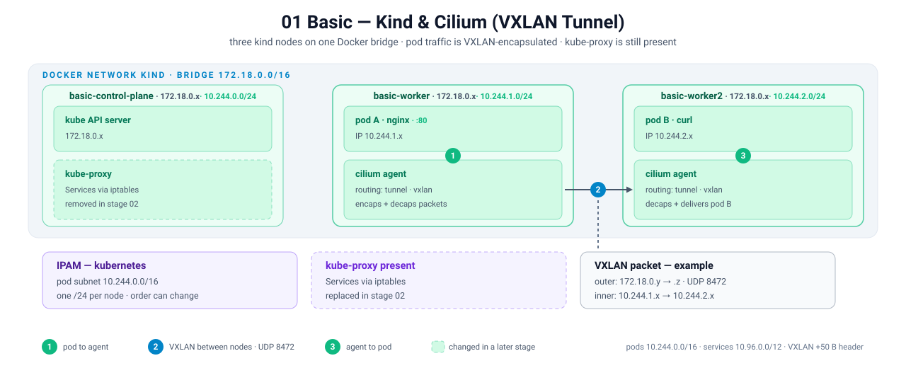
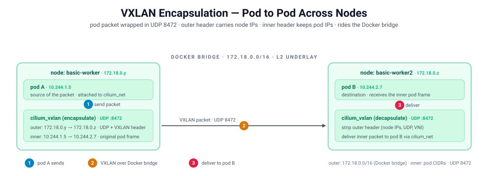
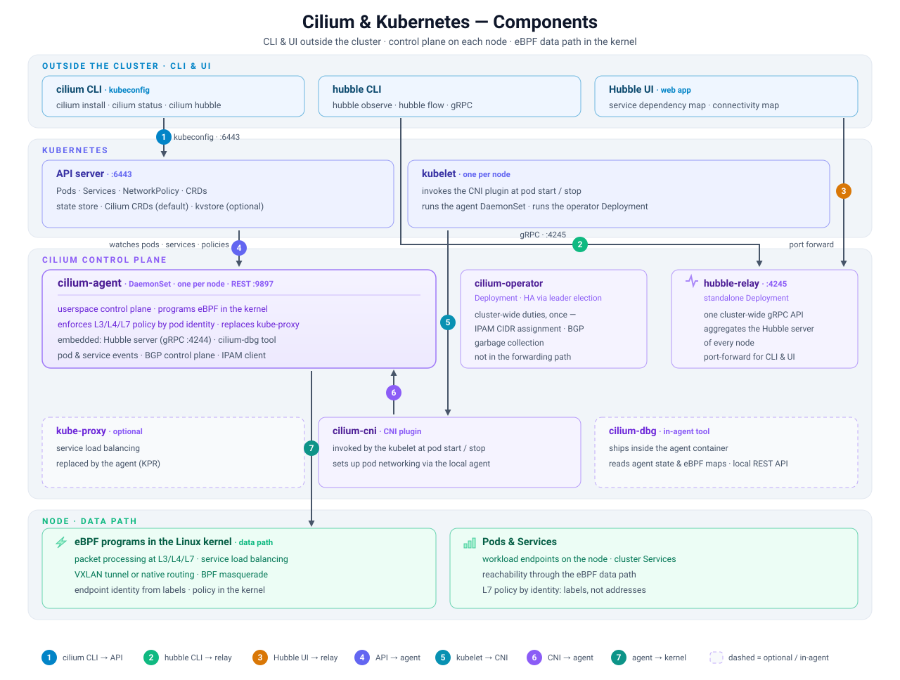

# Deployment

Smallest useful Cilium Kind cluster.



## Kind

Store following Kind configuration to `kind.yaml`:

```yaml
kind: Cluster
apiVersion: kind.x-k8s.io/v1alpha4
networking:
  disableDefaultCNI: true      # kindnet off; Cilium is the CNI. kube-proxy stays on.
nodes:
- role: control-plane
- role: worker
- role: worker
```

Kind installs a custom CNI plugin called `kindnet` ...disable this default with `networking.disableDefaultCNI`

```bash
#  Create the cluster ...name `basic`
kind create cluster --name basic --config kind.yaml
```

## Cilium

```bash
# Install the Cilium Helm chart (from cilium-cli) 
cilium install  

# Check deployment progress
cilium status [--wait]
```
Cilium Does not need a local Helm chart or the `helm` command. Before the install cilium...

- ...examines node labels of the cluster ...Kind labels node `name: kind-basic`
- ...recognizes Kind labels ...adds Helm values that fit a local Kind cluster

Cilium on Kind default configuration:

- **`ipam.mode: kubernetes`**
  -  Kind starts the control plane with the pod sub-network `10.244.0.0/16`...
  -  ...the `kube-controller-manager` hands out a `/24` to each node
  -  Cilium reuses those ranges instead of building its own IP pool
- **`operator.replicas: 1`**
  - Helm chart ships two replicas for production high availability
  - For a Kind cluster one replica saves memory on the host
- **`routingMode: tunnel`**
  - Tunnel needs nothing from the underlying network
  - Docker bridge forwards node-to-node traffic

```bash
# Show the Helm values of the release cilium
helm -n kube-system get values cilium

# Show the agent configuration that Helm made from these values:
cilium config view | grep -E '^(ipam|routing-mode|tunnel-protocol|kube-proxy-replacement) '
```

# Configuration

Kind ("Kubernetes in Docker") – Kubernetes node as a Docker container

* Node containers connect to a **Docker bridge network** named `kind`
* Docker draws user-defined networks from a pool: `172.16.0.0/12`
* Each user gets the next free `/16` first `172.18.0.0/16`, then `172.19.0.0/16`...

```bash
# Address of each node on the Docker bridge under internal IP
kubectl get nodes -o wide

# Docker bridge configuration in JSON
docker network inspect kind

# bridge subnet and gateway
docker network inspect kind \
       --format '{{range .IPAM.Config}}{{.Subnet}} gateway {{.Gateway}}{{"\n"}}{{end}}'
```


## CNI Plugin

Kubernetes pod, aka group of containers:

- A new container has no network, no IP address
- **CNI plugin required to setup the pod/container network**
  - CNI (Container Network Interface)
  - Specification describes how a container runtime asks for container network

`kubelet` checks for CNI config files in `/etc/cni/net.d/`

- Until the first config file appears...
- ...node reports the condition `NetworkUnavailable` ...nodes stay `NotReady`
- ...since nodes are not ready ...scheduler keeps pods in `Pending`

```bash
# check the node network before installing cilium
kubectl describe node basic-worker | grep -A2 NetworkUnavailable
```

**Cilium is the CNI plugin** ...after it is installed:

- `cilium-agent` starts on each node ..config `/etc/cni/net.d/`
- The container runtime calls `/opt/cni/bin/cilium-cni`
  - Plugin creates a network interface pair (pod and node)
  - Assigns a pod IP address ...routes **traffic flow between pod and node**
- Node changes to `Ready`, and pods can start.


```bash
# Check the plugin files on a node
docker exec basic-worker ls /opt/cni/bin /etc/cni/net.d
```

## Pod IP-Addresses

IPAM (IP Address Management) ...assigns IP addresses to pods

* `ipam.mode: kubernetes`
  - Tells Cilium to take the addresses from the Kubernetes control plane (instead its pool)
  - Kind runs the control plane with the **cluster pod sub network `10.244.0.0/16`**
* Assignment happens in two steps:
  1. Node registers ...k8s provides a **`/24` IP range per node** (kind default, via `node.spec.podCIDR`)
  2. Pod starts ...Cilium provides the next free address from the node CIDR
* Pod IP starts with the digits of its node's range
* Nodes manage CIDR locally ...nodes do not coordinate for addresses

```bash
# Show CIDR of each node
kubectl get nodes -o custom-columns='NAME:.metadata.name,PODCIDR:.spec.podCIDR'
```

## Node-2-Node Traffic

Modes to facilitate node-to-node traffic:

- **Tunnel mode** = Wraps pod packets in node-to-node packets.
  - Encapsulates the full pod packet in UDP packages
  - Underlay only needs node-to-node reachability.
  - Pod CIDRs can be anything, even overlapping the underlay.
  - Cost: ~50 bytes overhead per packet, so pod MTU drops below the node MTU.
  - Decapsulation happens in BPF on the receiving node.
- **Routed mode** = Send pod packets directly (underlay routes pod CIDRs)
  - Pod packets go on the wire as-is, with pod IPs in the header.
  - The underlay must know routes to every pod CIDR (via the node IP).
  - Often needs BGP or static routes per pod CIDR on every switch.
  - No encapsulation overhead: full MTU, slightly lower CPU cost.
  - Pods use the node's MAC or an internal bridge for the last hop.

## VXLAN Tunnel

Layer 1 – **underlay** = Fabric, physical network (node-to-node reach-ability)

- The `kind` Docker bridge in this example
  - The bridge gives each node an IP in `172.18.0.0/16`.
  - Kind attaches each node container to the Docker bridge.
- These IPs are the VXLAN **VTEP addresses (tunnel endpoints)**
  - Underlay never sees pod IPs ...only packets between node IPs
  - It sees outer header (VXLAN header) ...UDP flow on port 8472

Layer 2 – **pod network** = Cilium defined virtual network (pod-to-pod traffic)

- Cilium creates **`cilium_vxlan` interface** on each node.
  - Encapulates each pod packet into **UDP port 8472**.
  - **Outer IP header** uses node's Docker-bridge IPs (`172.18.0.4 > 172.18.0.2`).
- VNI (VXLAN Network Identifier)...in outer frame ...identifies pod network
  - A single cluster normally uses one cluster VNI for all its pods.
  - VNI per node interface (not pod) ...pod identity is its inner IP (not VNI).

```bash
# Check the routing mode
kubectl -n kube-system exec ds/cilium -- cilium-dbg status | grep -i routing

# Check the tunnel device (shows id (VNI) and dstport)
docker exec basic-worker ip -d link show cilium_vxlan
```




## Kube-Proxy

Cilium connects pods. `kube-proxy` implements Kubernetes Services with iptables rules

```bash
# Show that kube-proxy is present
kubectl -n kube-system get ds kube-proxy
```


# Experiments

## Capture Tunnel Traffic

NGINX server pod on `basic-worker` and a Curl client pod on `basic-worker2`:

```bash
kubectl run srv \
      --image=nginx:1.31-alpine \
      --overrides='{"spec":{"nodeName":"basic-worker"}}'

kubectl run cli \
      --image=curlimages/curl:8.23.0 \
      --overrides='{"spec":{"nodeName":"basic-worker2"}}' \
      --command -- sleep infinity
```

Capture VXLAN packets on `basic-worker` (`netshoot` image includes `tcpdump`)

```bash
docker run --rm --net container:basic-worker nicolaka/netshoot \
      tcpdump -ni eth0 -c 4 udp port 8472
```

In parallel send a request from `cli` to `srv`

```bash
srv=$(kubectl get pod srv -o jsonpath='{.status.podIP}')
kubectl exec cli -- curl -s -o /dev/null -w '%{http_code}\n' "http://$srv" # expect 200
```

Examine the capture:

```txt
IP 172.18.0.4.51234 > 172.18.0.2.8472: VXLAN, flags [I] (0x08), vni 6789
IP 10.244.2.14.41234 > 10.244.1.9.80: Flags [S], seq 1234567890, win 64240, length 0
IP 172.18.0.2.40001 > 172.18.0.4.8472: VXLAN, flags [I] (0x08), vni 4321
IP 10.244.1.9.80 > 10.244.2.14.41234: Flags [S.], seq 987654321, ack 1234567891, win 65160, length 0
```
VXLAN packet have two IP headers

* **Outer header** node addresses `172.18.0.x`
* **Inner header** pod addresses `10.244.x.x`
* `vni` is the security identity of the source pod. `tcpdump` stops after 4 packets.

```bash
# clean up
kubectl delete pod srv cli
```

## Cilium Endpoints

Find the Cilium agent pod on `basic-worker`:

```bash
kubectl --namespace kube-system get pod \
     --selector k8s-app=cilium --output name \
     --field-selector spec.nodeName=basic-worker
```

Show the endpoints of this agent:

```bash
kubectl -n kube-system exec $cilium_agent_pod -- cilium-dbg endpoint list
```

Expected output (example, shortened):

```txt
ENDPOINT   POLICY (ingress)   POLICY (egress)   IDENTITY   LABELS (source:key[=value])          IPv4         STATUS 
           ENFORCEMENT        ENFORCEMENT
285        Disabled           Disabled          1          reserved:host                                     ready
1012       Disabled           Disabled          4          reserved:health                      10.244.1.77  ready
3021       Disabled           Disabled          31512      k8s:io.kubernetes.pod.namespace=...  10.244.1.12  ready
```

- Each pod on a node is one endpoint. (host and the health check are endpoints too)
- `IDENTITY` is the security identity. Pods with the same labels have the same identity.
- `POLICY ... Disabled`: no network policy selects the endpoint.

# Notes

Cilium[^fG41sa] integrates with Kubernetes networking & security through a CNI plugin

[^fG41sa]: Cilium Project  
<https://github.com/cilium/cilium>  
<https://docs.cilium.io/en/stable>

* Foundation of Cilium is a Linux kernel technology called eBPF[^0OLa1]
  - …eBPF can run sandboxed programs in an operating system kernel
  - …enables users to dynamically extend the capabilities of the kernel
* Leveraging Linux eBPF Cilium can…
  - …provide security visibility & enforcement based on service & pod identity
  - …facilitate traditional layer 3 and layer 4 segmentation
  - …filter an application layer (e.g. HTTP) …decouple security from addressing

[^0OLa1]: eBPF  
<https://ebpf.io>

## Components



Cilium core components[^P2C7m]:

[^P2C7m]: Cilium Components  
<https://docs.cilium.io/en/stable/overview/component-overview/>

* **Agent** (`cilium-agent`, DaemonSet, one per node): userspace control plane; programs eBPF, applies policies, replaces kube-proxy
* **CNI plugin** (`cilium-cni`): invoked by Kubernetes at pod start/stop; talks to the local agent to set up networking
* **Operator** (`cilium-operator`, Deployment, HA via leader election): cluster-wide duties once — IPAM CIDR assignment, BGP, garbage collection; not in the forwarding path
* **Debug CLI** (`cilium-dbg`): in-agent tool; reads agent state and eBPF maps via the local REST API
* **cilium CLI** (separate, installed outside the cluster): `cilium install`, `cilium status`, `cilium hubble`; uses kubeconfig

Hubble — Network observability layer of Cilium

* **Server**: embedded in the agent; gRPC flow API per node
* **Relay** (`hubble-relay`): standalone; aggregates all node servers into one cluster-wide API
* **CLI** (`hubble`): `hubble observe`, `hubble flow`; talks to relay or local server
* **UI** (`hubble-ui`): web app; dependency and connectivity map

### Agent

`cilium-agent` — Per-node daemon that does the eBPF work

What it does

* Listens to Kubernetes events for pod/container start and stop
* Loads and updates eBPF programs in the Linux kernel that filter and route all pod traffic
* Translates `NetworkPolicy` / `CiliumNetworkPolicy` into eBPF rules
* With `kubeProxyReplacement=true`: does service load balancing (ClusterIP, NodePort, LB) instead of kube-proxy
* Handles pod IPAM on the node (in `cluster-pool` mode, per-node /24 allocation)
* Runs the L7 proxy (Envoy) for HTTP/gRPC policy enforcement
* Exposes a local REST API for debugging (`cilium-dbg`)

```bash
# List all agent pods
kubectl -n kube-system get pods -l k8s-app=cilium -o wide

# Agent state form inside the pod
kubectl -n kube-system exec -it $agent_pod -- cilium-dbg status

# Logs files of a specific agent
kubectl -n kube-system logs $agent_pod
```

### CNI Plugin

`cilium-cni` — Short-lived, event-triggered, in the kubelet's code path

* ...plugin present on every node (not a running process)
* ...invoked by the kubelet per pod (actual work done by `cilium-agent`)
* How it works
  - Binary ships inside the cilium-agent container
  - Agent copies/links it into the node's CNI directory (`/opt/cni/bin`)
  - CNI config in `/etc/cni/net.d/10-cilium.conflist`
  - Kubelet executes the binary once with the pod's network config
  - Plugin talks to the agent on the same node (local API/socket) to set up the datapath

## Terminology

### Endpoint

Cilium endpoint[^xSd23] — Each pod equals one endpoint

[^xSd23]: Cilium Endpoint, Cilium Documentation  
<https://docs.cilium.io/en/stable/gettingstarted/terminology/#endpoints>

* Each endpoint gets...
  - **IP address(es)**  (interfaces in the pod's network namespace)
  - **CID** — a numeric ID local to its agent (used in eBPF maps)
  - Security **identity** — a cluster-wide numeric ID derived from labels
* A pod that moves nodes gets a new CID but keeps the same identity
* Trace logs: identity vs endpoint ID are different things in the same line
* 
One **CiliumEndpoint CRD** per pod (same name and namespace as the pod)

* Use `cilium-dbg endpoint` from inside and agent pod
* Shows: IP, identity, state, interfaces, labels, applied policy

```bash
# List all endpoints
kubectl get ciliumendpoints -A

# Endpoints on a specific cilium-agent (CID in the first column)
kubectl -n kube-system exec $agent_pod -- cilium-dbg endpoint list

# Introspect an endpoint configuration
kubectl -n kube-system exec cilium-hlww8 -- cilium-dbg endpoint get $cid -o yaml
```

### Services

Cilium implements Kubernetes services directly in eBPF (replaces `kube-proxy`[^e7FgV])

[^e7FgV]: Kubernetes Without `kube-proxy`, Cilium Documentation  
<https://docs.cilium.io/en/stable/network/kubernetes/kubeproxy-free>

* `cilium-agent` watches Service/Endpoint objects ...programs eBPF LB maps on every node
* `ClusterIP`, `NodePort`, `LoadBalancer`, `externalIPs`, `hostPort` — all handled by the agent
* No iptables/IPVS rules; load balancing happens in the kernel
* Enabled with `kubeProxyReplacement=true` in Helm values
* Works in direct routing and tunnel mode

```bash
# Frontends and their backends per node
kubectl -n kube-system exec ds/cilium -- cilium-dbg service list
```

## Configuration

Pod **IPAM**[^e3W2q] (IP Address Manager)

[^e3W2q]: IPAM Modes, Cilium Documentation  
<https://docs.cilium.io/en/latest/network/kubernetes/ipam>

```bash
# check IPAM configuration
cilium config view | grep '^ipam '
```

Core modes (multiple cloud provider modes are available)

| Feature | kubernetes | cluster-pool | multi-pool |
|---|---|---|---|
| CIDR source | Kubernetes API | Cilium operator | Cilium operator |
| CIDRs per cluster | 1 | multiple | multiple |
| CIDRs per node | 1 | 1 | multiple |
| Dynamic allocation | no | no | yes |
| Tunnel routing | yes | yes | yes |
| Direct routing | yes | yes | yes |
| Extra setup | node-cidr flags on API server | none | none |
