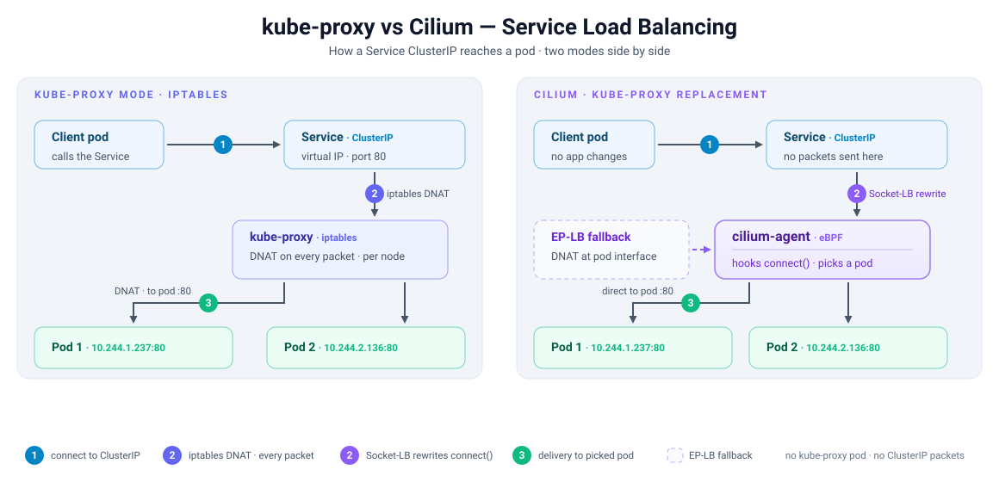
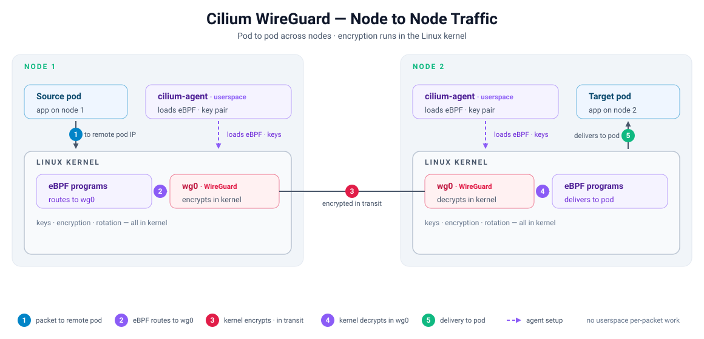

# Deployment

## Kind

```bash
kind create cluster --name beta --config kind.yaml
```

Kind configuration in `kind.yaml`

* **`networking.kubeProxyMode: none`**
  - Disable `kube-proxy`
  - Cilium replaces it with eBPF-based service load balancing
* Rest it the same as in the alpha example

Make sure that kube-proxy is not present

```bash
kubectl -n kube-system get ds kube-proxy
# should return an error 
```

## Cilium

```bash
cilium install --values cilium.yaml

# Check deployment progress
cilium status [--wait]
```

Configuration in `cilium.yaml`

* **`hubble.relay.enabled: true`** — Runs Hubble relay
* **`hubble.ui.enabled: true`** — Runs Hubble UI
* **`encryption.enabled`** & **`encryption.type: wireguard`** — Encrypts pod-to-pod traffic with WireGuard
  
Cilium install finds that `kube-proxy` is not present and configures:

* **`kubeProxyReplacement`** — 
* **`k8sServiceHost`** & **`k8sServicePort`** — Address and port of the API server
  - `cilium-agent` must connect to the Kubernetes API server
  - Without `kube-proxy`, nothing implements this Service before Cilium starts
  - Cilium must use the real address of the API server.
  - `cilium-cli` reads it from the EndpointSlice `default/kubernetes`.

Validate that the Cilium agent is running in the desired mode:

```bash
>>> kubectl -n kube-system exec ds/cilium -- cilium-dbg status --verbose
#...
KubeProxyReplacement Details:
  Status:                True
  Socket LB:             Enabled
  Protocols:             TCP, UDP
  Devices:               eth0    172.19.0.3 [...] (Direct Routing)
  Mode:                  SNAT
#...
  - ClusterIP:      Enabled
  - NodePort:       Enabled (Range: 30000-32767)
  - LoadBalancer:   Enabled
  - externalIPs:    Enabled
  - HostPort:       Enabled
#...
```
  
# Configuration

## Cilium Service



Kubernetes defaults to make service IPs reachable using `kube-proxy`[^9eW2q]

[^9eW2q]: Virtual IPs and Service Proxies, Kubernetes Documentation  
<https://kubernetes.io/docs/reference/networking/virtual-ips>

**Cilium replaces the `kube-proxy`[^T56Fg] with eBPF programs**

[^T56Fg]: Kubernetes Without kube-proxy, Cilium Documentation  
<https://docs.cilium.io/en/stable/network/kubernetes/kubeproxy-free>

* `NodePort`, `LoadBalancer`, `ExternalIP`, and session affinity...
* ...all handled by the same eBPF layer.

Stage 1 — Load balance at the socket, before any packet is sent

* Called **Socket-LB** (fast path, on by default)
* eBPF hooks the `connect()` syscall on pods and the host
* When a process connects to a service `ClusterIP`...
* ...cilium picks a backend pod and rewrites the destination socket
* No packet is sent to the `ClusterIP` at all

Stage 2 — Load balance at the network layer, when packets flow

* **EP-LB** (aka Endpoint Load Balancing, fallback)
* Used when socket-LB cannot apply...
  - ...eBTC programs on pod interfaces (ingress/egress)
  - ...DNAT on each packet that needs it. Picks a pod from a BPF map.

## WireGuard



**Cilium encrypts pod-to-pod traffic[^L2D12] between nodes using WireGuard[^8uYtr]**

[^L2D12]: Transport Encryption, Cilium Documentation  
<https://docs.cilium.io/en/latest/security/network/encryption/>

[^8uYtr]: WireGuard Transparent Encryption, Cilium Documentation  
<https://docs.cilium.io/en/latest/security/network/encryption-wireguard>

- Why use it?
  - Protect cluster internal network traffic on shared infrastructure
  - Simpler then alternatives ...good performance (Linux kernel)
- How it works...
  - `cilium-agent` creates WireGuard tunnels to every other node
  - Node generate their own key pair (public key in CiliumNode object)
  - Kernel handles encryption and key rotation
  - No user-space agent does per-packet work
  - Only traffic between Cilium-managed endpoints across nodes encrypted

Verify that transport encryption uses Wireguard

```bash
kubectl -n kube-system exec ds/cilium -- cilium-dbg status | grep -i 'encryption'
```

# Topics

## Hubble

Hubble[^O3sx5] — Distributed networking and security observability platform

[^O3sx5]: Hubble Documentation  
<https://docs.cilium.io/en/stable/observability/hubble>

* What it does...
  - Shows service dependencies and a communication map
  - Helps in network monitoring & alerting
  - Enables security observability for network connections
  - Application monitoring
* How it works...
  - `cilium-agent` records flows through its eBPF programs
  - `hubble-relay` collects the flows of all nodes
  - `hubble` CLI and the Hubble UI read the flows from the relay

Open a port forward to Hubble Relay...

```bash
# ...keep it open in a second terminal
cilium hubble port-forward

# Open the Web UI in a browser
cilium hubble ui
```

Show flows...

```bash
hubble observe -n $namespace --last 20
# only dropped
hubble observe -n $namespace --verdict DROPPED
```

## Network Policy

Network policy controls which pods can talk to which other pods

* Kubernetes support `NetworkPolicy`[^Lp0E3] (by default)
* Works at **OSI layers 3 & 4** (based on IP, protocol, port)
* Cilium supports this standard type and adds adds **OSI layer 7** (HTTP, DNS, gRPC) 

[^Lp0E3]: Network Policies, Kubernetes Documentation  
<https://kubernetes.io/docs/concepts/services-networking/network-policies>

Cilium enforces network policy[^I4Df3] via eBPF (identity-based rules)

[^I4Df3]: Overview of Network Policy, Cilium Documentation  
<https://docs.cilium.io/en/stable/security/policy>

* Pods get a numeric identity from labels ..policies match identities instead of IPs.
* Policy resources
  - `CiliumNetworkPolicy` — extended CRD: L7 (HTTP, gRPC), FQDN egress, CIDR rules
  - `CiliumClusterwideNetworkPolicy` — same as above, cluster-scoped (no namespace)
  - Cilium implements a subset of `NetworkPolicy` spec; unsupported fields are dropped

Cilium runs Envoy[^w3Ed1] as the **L7 proxy** (HTTP/gRPC policy enforcement)

[^w3Ed1]: Envoy Project  
<https://www.envoyproxy.io>

* Division of labor
  - eBPF programs handle L3/L4 fast in the kernel (routing, load balancing, L3/4 policy)
  - Traffic that needs L7 inspection is redirected out of the kernel to the local Envoy process
  - Envoy parses HTTP/gRPC and applies `CiliumNetworkPolicy` L7 rules
  - Approved packets are forwarded on; denied ones are dropped with a Hubble trace
* Why both?
  - eBPF is fast but cannot fully decode HTTP in-kernel for every case
  - Envoy gives protocol understanding, at the cost of a userspace hop
  - Only pods with L7 policies involve Envoy; pure L3/4 traffic never touches it


# Experiments

## Simple Service

Deploy a example "beta" service in a demo namespace (cf. `beta-service.yaml`)

```bash
>>> kubectl apply -f beta-service.yaml
>>> kubectl -n demo get pods 
NAME                    READY   STATUS    RESTARTS   AGE
beta-5d4d66cddc-ckt7h   1/1     Running   0          46s
beta-5d4d66cddc-k9p5w   1/1     Running   0          46s

>>> kubectl -n demo get service beta-nginx
NAME         TYPE        CLUSTER-IP     EXTERNAL-IP   PORT(S)   AGE
beta-nginx   ClusterIP   10.96.75.175   <none>        80/TCP    49s
```

Show the **service table in Cilium**:

```bash
>>> kubectl -n kube-system exec ds/cilium -- cilium-dbg service list
ID   Frontend               Service Type   Backend                               
#...
11   10.96.75.175:80/TCP    ClusterIP      1 => 10.244.1.237:80/TCP (active)     
                                           2 => 10.244.2.136:80/TCP (active)
```

How to read the output...

- `ID` — Internal service ID (matches the map key).
- `Frontend` — Service virtual IP and port
- `Service Type` — Type of the service ...here `ClusterIP`
- `Backend `— Pods the traffic is send to...
  - For example `1 => 10.244.1.237:80/TCP (active)`
    - One backend ...pod IP 10.244.1.237 ...port 53
    - The `1` is a backend index
    - `active` means it is ready to receive traffic.
  - Multiple lines = multiple pods behind the Service (round-robin among them).

For testing we use `curl` deployed from a dedicated pod:

```bash
# start a pod for interactive tests
kubectl apply -f beta-client.yaml
```

```bash
# Send a request (should answer with 200)
kubectl -n demo exec beta-client \
      -- curl -s -o /dev/null -w '%{http_code}\n' http://beta-nginx/
# ...using the frontend IP
kubectl -n demo exec beta-client \
      -- curl -s -o /dev/null -w '%{http_code}\n' http://10.96.75.175:80/
```

```bash
kubectl -n demo exec beta-client \
      -- curl -s -o /dev/null -w '%{http_code}\n' -X POST http://beta-nginx/
# return 405 (Method Not Allowed)

kubectl -n demo exec beta-client \
      -- curl -s -o /dev/null -w '%{http_code}\n' http://beta-nginx/some/path
# return 404 (Not Found)
```

## Network Policy

Apply an L3/L4 + L7 policy for connections to the beta service:

* Effect: only the beta client may send an HTTP GET to "/" on the server, port 80/TCP.
* Everything else to the server is denied (the server pods are now policy-selected).

```
apiVersion: cilium.io/v2
kind: CiliumNetworkPolicy
metadata:
  name: beta-nginx-get-access
  namespace: demo
spec:
  # Which pods this policy protects. A single selector object (a map), not a list.
  endpointSelector:
    matchLabels:
      app: beta-nginx
  # Ingress rules. Each top-level list item is one rule; rules are OR-ed.
  ingress:
    - # Who may connect in. A list of endpoint selectors, OR-ed together.
      fromEndpoints:
        - matchLabels:
            # Must equal the client pod's actual label
            app: beta-curl
      # Destination port and protocol on the selected endpoints.
      toPorts:
        - ports:
            - port: "80"
              protocol: TCP
          # Layer-7 (HTTP) rules, applied on top of the L3/L4 match.
          rules:
            http:
              - method: "GET"
                # Exact path. "/*" would match all paths.
                path: "/"
```

Above is stored in `beta-policy.yaml`

```bash
# deploy the network policies
kubectl apply -f beta-policy.yaml

# all policies in the demo namespace
kubectl -n demo get ciliumnetworkpolicies

# a single policy in detail
kubectl -n demo get ciliumnetworkpolicies beta-nginx-get-access -o yaml
```

An HTTP `POST` and access for a path other then `/` should be blocked:

```bash
kubectl -n demo exec beta-client \
      -- curl -s -o /dev/null -w '%{http_code}\n' -X POST http://beta-nginx
# returns 403 (Forbidden)

kubectl -n demo exec beta-client \
      -- curl -s -o /dev/null -w '%{http_code}\n' http://beta-nginx/some/path
# returns 403 (Forbidden)
```

Send a request from a pod that the policy does not allow

```bash
kubectl -n demo run other --rm -i --restart=Never \
      --image=curlimages/curl:8.23.0 --command \
      -- curl -s -m 3 -o /dev/null -w '%{http_code}\n' http://beta-nginx/
# return 000 (after 3 seconds), server never answered
```

Cilium dropped the packets at L3, so the TCP connection did not start

## HTTP POST Access

```bash
kubectl apply -f - <<'EOF'
apiVersion: cilium.io/v2
kind: CiliumNetworkPolicy
metadata: 
  name: beta-nginx-post-access
  namespace: demo
spec:
  endpointSelector: 
    matchLabels: 
        app: beta-nginx
  ingress:
    - fromEndpoints: 
      - matchLabels:
          app: beta-curl
      toPorts:
      - ports:
          - port: "80"
            protocol: TCP
        rules:
          http:
            - method: "POST"
              path: "/"
EOF
```

```bash
kubectl -n demo exec beta-client \
      -- curl -s -o /dev/null -w '%{http_code}\n' -X POST http://beta-nginx
# return 405 (Method Not Allowed)
```

Nginx sends not allowed, because it does not accept `POST` for a static file

```bash
# clean up
kubectl -n demo delete ciliumnetworkpolicies  beta-nginx-post-access
```