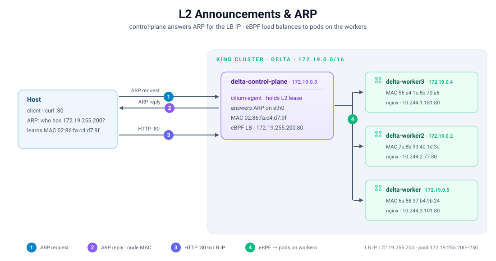

# Deployment

## Kind

Delta = gamma (native routing) plus one new key: **layer-2 (L2) announcements**

```bash
# start the Kubernetes cluster
kind create cluster --name delta --config kind.yaml
```

Name, IP- and MAC-addresses of all the kind nodes

```bash
for node in $(kind get nodes --name delta); do
  ip=$(docker inspect "$node" -f '{{range .NetworkSettings.Networks}}{{.IPAddress}}{{end}}')
  mac=$(docker inspect "$node" -f '{{range .NetworkSettings.Networks}}{{.MacAddress}}{{end}}')
  printf '%-20s %-16s %s\n' "$node" "$ip" "$mac"
done
```
```txt
delta-control-plane  172.19.0.3       02:86:fa:c4:d7:9f
delta-worker2        172.19.0.2       7e:5b:99:40:1d:3c
delta-worker3        172.19.0.4       56:a4:1e:5b:70:a6
delta-worker         172.19.0.5       6a:58:37:b4:9b:24
```

## Cilium

```bash
cilium install --values cilium.yaml
```

With **`l2announcements.enabled: true`** - Advertises pod IPs to devices outside the cluster 

Find the network prefix for the kind cluster, here `172.19.`

```bash
>>> docker network inspect kind -f '{{range .IPAM.Config}}{{println .Subnet}}{{end}}' 
fc00:f853:ccd:e793::/64
172.19.0.0/16
```

Configure the load-balancer and L2 announcement **with the right prefix**:

```yaml
kubectl apply -f - <<'EOF'
apiVersion: cilium.io/v2
kind: CiliumLoadBalancerIPPool
metadata:
  name: delta-pool
spec:
  blocks:
  - start: "172.19.255.200"
    stop:  "172.19.255.250"
---
apiVersion: cilium.io/v2alpha1
kind: CiliumL2AnnouncementPolicy
metadata:
  name: delta-pool
spec:
  loadBalancerIPs: true
  interfaces: ["^eth[0-9]+"]
EOF
```

Show the pool and the number of free addresses

```bash
>>> kubectl get ciliumloadbalancerippools
NAME         DISABLED   CONFLICTING   IPS AVAILABLE   AGE
delta-pool   false      False         50              6m6s
```
  
# Configuration

## Load-Balance

LoadBalancer IP Address Management[^Z321A] (LB-IPAM) is a controller in the `cilium-operator`

[^Z321A]: LoadBalancer IP Address Management, Cilium Documentation  
<https://docs.cilium.io/en/stable/network/lb-ipam>

* Responsible for allocation and **assigning of IPs to Service objects**
  - Always enabled but dormant
  - Awoken when the first IP Pool is added to the cluster
* How it works....
  - A CiliumLoadBalancerIPPool holds blocks of addresses, e.g. 172.18.255.200-250
  - The controller watches Services with type: LoadBalancer
  - For each, it takes a free address and writes it to `status.loadBalancer.ingress[0].ip`
* What it does not do...
  - It only allocates. It does not make the IP reachable.
  - Reachability comes in conjuntion with other components
    - L2 announcements (local)
    - BGP control plane

## L2 Announcement

L2 announcements[^P2asW] make one Kind node answer ARP for a LoadBalancer IP

[^P2asW]: L2 Announcements / L2 Aware LB, Cilium Documentation  
<https://docs.cilium.io/en/stable/network/l2-announcements>

* ...so the host can reach that IP on the Docker bridge
* How it works...
  - The host asks: "who has 172.18.255.200?" (ARP request)
  - One `cilium-agent` replies with its own MAC address, on interface eth0.
  - The host then sends packets to that MAC. eBPF load balances them to the pods.
* Why one node?
  - Two nodes must not answer for the same IP.
  - Cilium uses a Kubernetes lease per Service to pick one node (leader election).
  - If the node dies, the lease expires ...another node takes over ...sends a gratuitous ARP


```bash
# get the list of leases
>>> kubectl -n kube-system get lease | grep l2announce
cilium-l2announce-default-delta-service   delta-control-plane   #...
```

The second column is the node that holds the lease. This node answers ARP for the IP address.


# Experiments

```vash
# deploy and example service
kubectl apply -f delta-service.yaml
```

Check service deployment

```bash
>>> kubectl get pods -l app=delta-nginx -o custom-columns=NAME:.metadata.name,NODE:.spec.nodeName,POD-IP:.status.podIP
NAME                           NODE            POD-IP
delta-nginx-56c46c44bc-8qwh6   delta-worker3   10.244.1.181
delta-nginx-56c46c44bc-drctf   delta-worker2   10.244.2.77
delta-nginx-56c46c44bc-prkfc   delta-worker    10.244.3.101
```

## Load-Balance

```bash
kubectl apply -f delta-service.yaml
```

...using a service of type `LoadBalancer`:

```yaml
apiVersion: v1
kind: Service
metadata:
  name: delta-service
spec:
  type: LoadBalancer
  selector:
    app: delta-nginx
  ports:
  - port: 80
    targetPort: 80
```

```bash
>>> kubectl get service delta-service
NAME            TYPE           CLUSTER-IP     EXTERNAL-IP      PORT(S)        AGE
delta-service   LoadBalancer   10.110.74.33   172.19.255.200   80:32530/TCP   85s
```

Send requests from the host:

```bash
curl -s -o /dev/null -w '%{http_code}\n' "http://172.19.255.200"
```

Verify that the host knows about the MAC-addresses

```bash
>>> ip neigh show | grep 172.19
172.19.0.5 dev br-2cb6c5a43d7a lladdr 6a:58:37:b4:9b:24 STALE 
172.19.0.2 dev br-2cb6c5a43d7a lladdr 7e:5b:99:40:1d:3c REACHABLE 
172.19.0.3 dev br-2cb6c5a43d7a lladdr 02:86:fa:c4:d7:9f STALE 
172.19.0.4 dev br-2cb6c5a43d7a lladdr 56:a4:1e:5b:70:a6 STALE 
172.19.255.200 dev br-2cb6c5a43d7a lladdr 02:86:fa:c4:d7:9f STALE 
```

## Static IP-Address

Request a specific address using the annotation `lbipam.cilium.io/ips`

```bash
kubectl apply -f - <<EOF
apiVersion: v1
kind: Service
metadata:
  name: delta-static
  annotations: 
    lbipam.cilium.io/ips: "172.19.255.240"
spec:
  type: LoadBalancer
  selector: 
    app: delta-nginx
  ports:
  - port: 80
    targetPort: 80
EOF
```

Check the service state

```bash
>>> kubectl get service 
NAME            TYPE           CLUSTER-IP       EXTERNAL-IP      PORT(S)        AGE
delta-service   LoadBalancer   10.110.74.33     172.19.255.200   80:32530/TCP   18m
delta-static    LoadBalancer   10.108.248.246   172.19.255.240   80:30370/TCP   72s
kubernetes      ClusterIP      10.96.0.1        <none>           443/TCP        35m

>>> kubectl -n kube-system get lease | grep l2announce
cilium-l2announce-default-delta-service   delta-control-plane        #...
cilium-l2announce-default-delta-static    delta-control-plane        #...
```

Query the service via the static IP:

```bash
curl -s -o /dev/null -w '%{http_code}\n' "http://172.19.255.240"
```