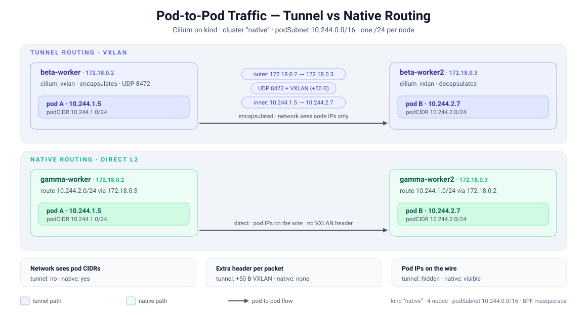

# Deployment

```bash
kind create cluster --name gamma --config kind.yaml
```

Kind configuration:

* **`disableDefaultCNI: true`** — kind installs no CNI. Cilium must provide networking.
* **`kubeProxyMode: none`** — `kube-proxy` disabled. Cilium handles Service load balancing (eBPF).
* **`podSubnet`** / **`serviceSubnet`** — IP ranges for Pods and ClusterIP Services. Cilium uses these.

```bash
cilium install --values cilium.yaml

# Check deployment progress
cilium status [--wait]
```

Cilium configuration:

* **`routingMode: native`** — Pods get real cluster IPs. Traffic uses node routing, no tunnels.
* **`ipv4NativeRoutingCIDR: 10.244.0.0/16`** — Must match podSubnet in `kind.yaml`.
* **`autoDirectNodeRoutes: true`** — Cilium adds routes to other nodes automatically.
* **`bpf.masquerade: true`** — SNAT Pod traffic leaving the cluster
* **`hubble.relay.enabled: true`** — Runs the Hubble Relay so you can query L7 traces.
  
# Configuration

## Native Routing

* In tunnel mode (in alpha & beta) ...Docker bridge sees only node addresses
* In native routing mode the **Docker bridge sees the pod addresses directly**
* All nodes must know where each pod CIDR is

| | Tunnel | Native |
|-|--------|--------|
| Network must know pod CIDRs | no | yes |
| Extra header on each packet | yes (50 bytes for VXLAN) | no |
| Pod IP addresses visible on the wire | no | yes |

## Node Routes

All kind nodes connect to the same Docker bridge (one L2 segment)...

* ...nodes can send packets directly to any other node
  -  If nodes are in different L2 segments
  -  ...routers must know the pod CIDRs (for example through BGP)
* `autoDirectNodeRoutes: true` ...`cilium-agent` adds a route for the pod CIDR of each other node
* `ipv4NativeRoutingCIDR` tells Cilium which destinations it can reach without masquerading (SNAT)
  - Cilium does not change the source address of packets to this CIDR
  - Packets to all other destinations (for example the internet) get the node IP address as the source address.
* `bpf.masquerade: true` tells Cilium to do the SNAT in eBPF, not with iptables rules. 

```bash
kubectl -n kube-system exec ds/cilium \
      -- cilium-dbg status | grep -iE 'routing|masquerading'
```

# Topics

# Experiments

## Pod Addresses

Deploy a simple version of the beta example:

```bash
kubectl run gamma-nginx --image=nginx:1.31-alpine \
      --overrides='{"spec":{"nodeName":"gamma-worker"}}'
kubectl run gamma-curl --image=curlimages/curl:8.23.0 \
      --overrides='{"spec":{"nodeName":"gamma-worker2"}}' \
      --command -- sleep infinity
```

Trace the package flow between nodes (in one terminal):

```bash
docker run --rm --net container:gamma-worker nicolaka/netshoot \
      tcpdump -ni eth0 -c 10
```

Query the Nginx service with `curl`

```bash
# get the IP address of the Nginx server
gamma_nginx=$(kubectl get pod gamma-nginx -o jsonpath='{.status.podIP}')
kubectl exec gamma-curl \
      -- curl -s -o /dev/null -w '%{http_code}\n' "http://$gamma_nginx"
```

You should see packages with IP addresses from the pods:

```BASH
.... IP 10.244.3.52.50524 > 10.244.1.69.80 ...
```

Take a look to the IP addreses

```bash
# CIDRs per Kubernetes node
>>> kubectl get nodes -o custom-columns='NAME:.metadata.name,PODCIDR:.spec.podCIDR'
NAME                  PODCIDR
gamma-control-plane   10.244.0.0/24
gamma-worker          10.244.1.0/24
gamma-worker2         10.244.3.0/24
gamma-worker3         10.244.2.0/24

# IP addresses for each pod
>>> kubectl get pods -o custom-columns=NAME:.metadata.name,IP:.status.podIP
NAME          IP
gamma-curl    10.244.3.52
gamma-nginx   10.244.1.69
```

You can check the client IP on the Nginx server:

```bash
>>> kubectl logs gamma-nginx | grep 10.244
10.244.3.52 - - [16/Nov/2026:09:56:20 +0000] "GET / HTTP/1.1" 200 896 "-" "curl/8.23.0" "-"
10.244.3.52 - - [16/Nov/2026:09:56:24 +0000] "GET / HTTP/1.1" 200 896 "-" "curl/8.23.0" "-"
10.244.3.52 - - [16/Nov/2026:09:56:32 +0000] "GET / HTTP/1.1" 200 896 "-" "curl/8.23.0" "-"
```

## Route Propagation

```bash
# routing table on one of the nodes
>>> docker exec gamma-worker ip route | grep 10.244
10.244.0.0/24 via 172.19.0.2 dev eth0 proto kernel 
10.244.2.0/24 via 172.19.0.5 dev eth0 proto kernel 
10.244.3.0/24 via 172.19.0.4 dev eth0 proto kernel
#...
```

Remove one of the workers and observer how the route gets removed

```bash
kubectl delete node gamma-worker3
```

The route to `gamma-worker3` should been removed

```bash
# restart Kubernetes on the worker
docker exec gamma-worker3 systemctl restart kubelet
kubectl get node gamma-worker3
```

The route to `gamma-worker3` should be back. The node can get a different pod CIDR than before.

